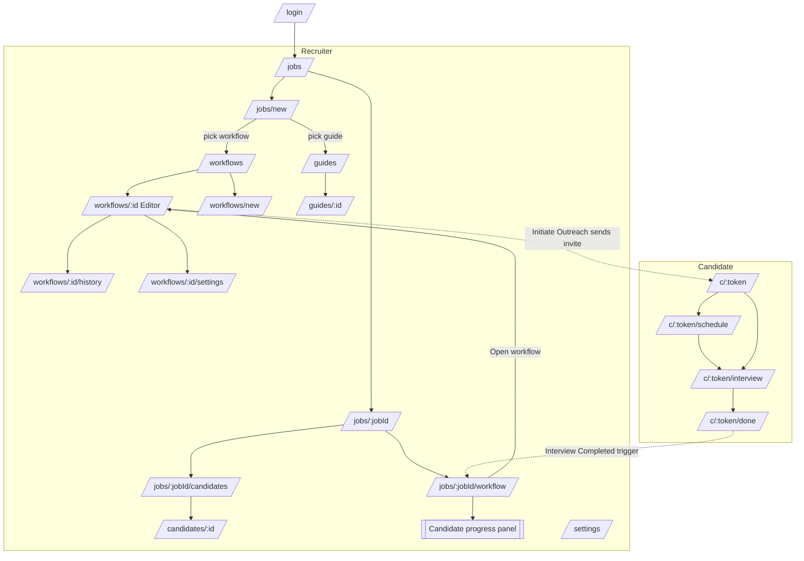

# Plan: mock page flow

| | |
|---|---|
| Goal | A clickable mock of the whole platform, so the flow can be reviewed before any backend exists |
| Scope | **Frontend only.** Static TypeScript fixtures, no API, no database, no real auth, no real messages |
| Spec | [`docs/prd/application-workflows.md`](../prd/application-workflows.md) (requirements `FR-n`) |
| Status | Phase 0 done — 2026-10-01 |

**How to use:** tick a box (`- [x]`) in the same commit that lands the item. A phase is done when
all its boxes are ticked and `pnpm lint && pnpm typecheck && pnpm build` pass.

## Conventions

- Recruiter pages live in a route group `apps/web/app/(app)/` sharing one shell (sidebar + header).
  Candidate pages live in `apps/web/app/c/[token]/` with their own minimal, mobile-first layout.
- Mock data lives in `apps/web/lib/mock/*.ts`, typed after PRD §6. Pages read fixtures directly;
  edits are kept in client state only and reset on reload.
- shadcn components are added with `pnpm dlx shadcn@latest add <c> -c apps/web`, never hand-written.
- The workflow canvas uses `@xyflow/react`.
- Next.js here is 16.x: read `apps/web/node_modules/next/dist/docs/01-app/` before writing routes.
- Every page is checked in light and dark mode.

## Page flow

Sidebar navigation: **Jobs**, **Workflows**, **Interview guides**, **Settings**.

## Phase 0 — Foundation

- [x] Read the Next 16 App Router docs for layouts, route groups, dynamic routes and `params`
- [x] Add shadcn components: sidebar, tabs, table, card, badge, dialog, sheet, dropdown-menu, input,
      label, select, textarea, switch, tooltip, separator, avatar, breadcrumb, skeleton, sonner
- [x] Add `@xyflow/react` to `apps/web`
- [x] App shell `app/(app)/layout.tsx`: sidebar nav, header with breadcrumb, theme toggle, TH/EN
      switch (placeholder), user menu
- [x] Mock data module `lib/mock/`:
  - [x] types (Job, Candidate, Application, Workflow, Round, Block, Node, InterviewGuide, Run,
        StepExecution, HistoryEntry)
  - [x] fixtures: 4 jobs, ~30 candidates, 3 workflows, 3 guides, runs and history entries
  - [x] node catalogue: triggers (PRD §4.2), actions (§4.3), utilities (§4.4)
- [x] Replace the starter `app/page.tsx` with a redirect to `/jobs`

## Phase 1 — Jobs and candidates

- [ ] `/login` — mock sign-in form; any input goes to `/jobs`
- [ ] `/jobs` — job list: title, status, round count, attached workflow, candidate count; "New job"
- [ ] `/jobs/new` — create job form
  - [ ] basics (title, description, location)
  - [ ] rounds editor: add/remove/reorder, at least one round (FR-7); type AI or Human, Human shown
        disabled "coming later" (FR-8, FR-10); pick an interview guide per AI round (FR-9)
  - [ ] pick the one application workflow for the job (FR-1)
- [ ] `/jobs/[jobId]` — job layout with tabs: Overview, Candidates, Workflow
- [ ] `/jobs/[jobId]` Overview — summary cards: funnel by round, decisions, rounds list
- [ ] `/jobs/[jobId]/candidates` — table: name, current round, stage, decision, score, last activity;
      filter by round and decision; "Invite candidate" action (Manually Invited trigger)
- [ ] `/candidates/[id]` — profile: contact, channels (LINE/email/SMS), applications, interview
      score and report summary, notes

## Phase 2 — Workflow builder (core)

- [ ] `/workflows` — list: name, rounds, jobs-using count, last edited, draft/published (FR-5)
- [ ] `/workflows/new` — name it, start blank or from a pre-made template
- [ ] `/workflows/[id]` — builder layout with tabs Editor / History / Settings (FR-12)
- [ ] Editor canvas
  - [ ] round tabs across the top, one canvas per round (FR-2)
  - [ ] block rendering: one trigger node, then actions top to bottom (FR-3)
  - [ ] branch nodes (Is, Filter) with Yes / No paths (PRD §4.5)
  - [ ] Initiate Outreach rendered as a group containing Send LINE / Email / SMS / Wait steps (§4.4)
  - [ ] Move to Round and Wait nodes (FR-11)
- [ ] Editor left sidebar (FR-13)
  - [ ] Nodes tab: triggers, actions, utilities, searchable
  - [ ] Blocks tab: pre-made blocks and saved blocks (FR-17)
- [ ] Editing interactions (FR-14): drag a node onto the canvas, connect below another, reorder,
      delete
- [ ] Node configuration panel (FR-15)
  - [ ] message template editor with variable chips for Send Email / SMS / LINE
  - [ ] condition builder: statements joined by AND inside a set, sets joined by OR (§4.5)
  - [ ] duration picker for Wait; target round picker for Move to Round
  - [ ] field/value pickers for Update Decision, Update Application Stage, Update Field
- [ ] Validation (FR-16): one trigger per block, one block per trigger per round (FR-4), invitation
      messages only inside Initiate Outreach; errors listed and highlighted on the canvas
- [ ] Draft and publish (FR-18): unsaved indicator, Publish button, shared-workflow warning with
      job count (FR-5)
- [ ] "Save as block" on a block (FR-17)
- [ ] `/workflows/[id]/history` — audit log: who, when, expandable change list coloured
      added/removed/changed, canvas diff on the right, per-round tabs (FR-24)
- [ ] `/workflows/[id]/settings` — outreach hours window and timezone, default Asia/Bangkok
      (FR-19); candidate intake timing: on invite / on engagement / after interview (FR-20)

## Phase 3 — Tracking

- [ ] `/jobs/[jobId]/workflow` — read-only canvas of the job's workflow with a count badge on every
      trigger and action (FR-21)
- [ ] Candidate search on that tab, and a per-node candidate list (FR-22)
- [ ] Candidate progress panel (sheet): contact and status, current step and time spent there,
      timeline of steps with timestamps and green/red status, cancelled outreach steps (FR-22)
- [ ] "Change workflow" dialog and "Open workflow" link to the editor (FR-23, FR-6)

## Phase 4 — Interview guides and settings

- [ ] `/guides` — list: name, kind (generic / role / job), question count, used-by count
- [ ] `/guides/[id]` — editor: introduction, ordered questions, outro, evaluation criteria, question
      limit (FR-9)
- [ ] `/settings` — tabs
  - [ ] Channels: LINE Official Account, email sender, SMS sender (mock connect states)
  - [ ] Team: members and roles (recruiter, hiring manager, admin)
  - [ ] Defaults: org outreach hours, language (TH/EN)

## Phase 5 — Candidate side

Mobile-first, styled to feel at home when opened from a LINE message.

- [ ] `/c/[token]` — invitation landing: job, company, what to expect, Start now / Pick a time
- [ ] `/c/[token]/schedule` — pick a slot; confirmation state (Interview Scheduled trigger)
- [ ] `/c/[token]/interview` — mock AI interview as a chat: intro, questions from the guide, outro
      (Interview Started / Completed triggers)
- [ ] `/c/[token]/done` — thank-you and what happens next
- [ ] Expired or already-completed link state

## Phase 6 — Polish

- [ ] Seed PRD §5 scenarios A–D as the mock workflows so each can be walked end to end
- [ ] Empty states and loading skeletons for every list and the canvas
- [ ] Dark mode pass on every page
- [ ] Responsive pass: recruiter pages down to tablet, candidate pages on phone
- [ ] Keyboard pass on the builder: add, select, delete nodes
- [ ] `pnpm lint`, `pnpm typecheck`, `pnpm build` green
- [ ] Walkthrough of the full flow recorded (login → create job → build workflow → candidate
      interview → tracking)

## Out of scope for the mock

Backend and persistence, real authentication, real LINE/SMS/email sending, working human rounds and
scheduling (PRD phase v3), ATS or CRM integration, job workflows, real AI interviewing.

## Open questions

1. Confirm `@xyflow/react` for the canvas before Phase 2 starts.
2. TH/EN: a real i18n library in the mock, or English-only with a placeholder switch?
3. Should the mock be deployed somewhere for review, or run locally only?
